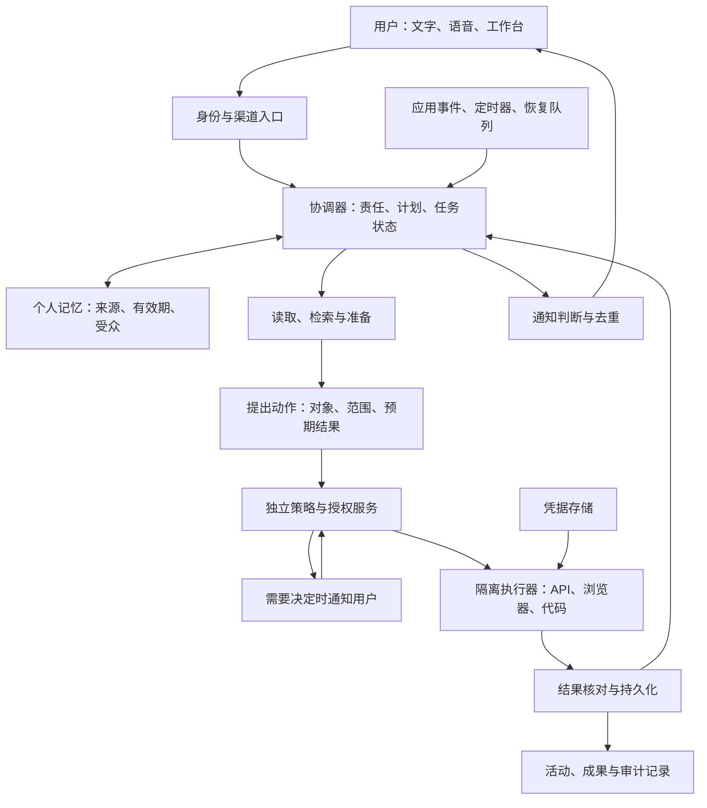

# Personal Agent 深度调研：商业产品、创业公司与开源生态

> 核验日期：**2026-10-22，Asia/Shanghai**。这是公开资料研究与产品设计分析，未登录各产品完成统一实测，也未审计完整源码。文中的“支持”表示一手资料已公开描述该能力，不表示本研究已验证其成功率。价格、地区、预览资格和配额均为查询时快照。
>
> 配套文档：[来源索引、仓库提交快照与核验记录](sources-2026-10-22.md)。本文引用编号可直接打开原始来源；开源仓库引用尽量固定到本次查询的提交。

## 目录

1. [核心结论](#1-核心结论)
2. [研究范围与判断标准](#2-研究范围与判断标准)
3. [商业产品与创业公司](#3-商业产品与创业公司)
4. [横向比较](#4-横向比较)
5. [开源产品与可自托管组件](#5-开源产品与可自托管组件)
6. [技术架构与关键设计](#6-技术架构与关键设计)
7. [商业模式与竞争判断](#7-商业模式与竞争判断)
8. [本项目的选型与产品建议](#8-本项目的选型与产品建议)
9. [后续实测方案](#9-后续实测方案)
10. [实施顺序与待验证问题](#10-实施顺序与待验证问题)

## 1. 核心结论

**Personal Agent 已经形成清晰的产品方向，但目前还不能根据公开演示排出可靠的能力总榜。** Grok Bot、Meta Muse、OpenAI Dots、Claude Duet、Today AI 和 Instinct 都把持续关系、个人上下文和真实执行放在中心。它们在地区、授权机制、配额、后台运行方式及公开透明度上差异很大。[S01]、[S06]、[S12]、[S17]、[S20]、[S23]

本研究的主要判断如下；其中涉及发展方向和本项目选择的内容属于研究判断。

1. **竞争单位正从一次回答转向一段持续责任。** 用户交给 Agent 的是“持续跟进这个项目”，系统要能等待、恢复、处理新信息并交回结果。Dots 的自主管理唤醒、Muse 的目标与事件处理、Duet 的后台检查，都体现了这个方向。[S08]、[S13]、[S17]
2. **记忆、主动性、执行能力需要一起工作。** 只有记忆，容易成为个性化聊天；只有定时器，容易成为自动简报；只有电脑操作，容易成为一次性任务执行器。可持续的价值来自“发现变化—判断是否重要—准备工作—获得必要授权—完成动作—更新状态”的闭环。
3. **云端电脑正在成为重要的执行底座。** 本次六个核心样本都公开提到电脑或云端执行能力，但各家的隔离和可接管程度不同。不能把“有一台电脑”当成“能可靠完成所有网站任务”。登录失效、验证码、站点限制和任务语义仍会决定结果。[S01]、[S06]、[S14]、[S17]、[S19]、[S23]
4. **授权和结果可核验程度会影响用户愿意交出多少责任。** Muse 公开了独立 Sentinel、凭据隔离和出站控制；Dots 区分只读主动研究与获授权任务；Duet 明确了敏感动作确认。公开说明的完整程度可以比较，实际防护效果仍需测试。[S07]、[S13]、[S15]、[S17]
5. **商业产品的入口成本低，持续使用成本与权限边界需要单独看。** Grok Bot 的新套餐共享周额度；Duet 的后台检查占用 Claude 配额；Dots 的委派任务计入 Work/Codex；“24 小时在线”不等于“24 小时持续推理且不限量”。[S03]、[S04]、[S12]、[S18]
6. **开源生态已经提供多条可行起点。** OpenClaw 偏多渠道控制面，Hermes 偏长期学习与技能，NanoClaw 偏容器隔离和可定制性，QwenPaw 偏中文渠道与本地模型，nanobot 偏 Python 小核心，nanoMuse 偏跨设备完整体验。选择应先看目标用户与运维能力。[S32]、[S33]、[S34]、[S35]、[S36]、[S38]
7. **现阶段不宜给所有产品打一个主观综合分。** 邀请制服务、刚发布的预览和自托管代码并非同等可用的样本。连接器数量、GitHub Star、融资额和厂商跑分也不能替代真实任务完成率。
8. **对本项目，优先验证“个人工作跟进”这一条闭环。** 建议先做邮件、日历、项目资料、GitHub 的连续跟进：记住承诺，准备会前材料，形成可审查的草稿和变更，再根据授权执行。该范围比同时覆盖购物、订票、健康和家庭更容易验证净收益。

## 2. 研究范围与判断标准

### 2.1 名称核对

| 用户提到的名称 | 本文采用名称 | 核验说明 |
| --- | --- | --- |
| grok bot | Grok Bot | Grok / Cursor 生态中的持续工作 Agent，有独立官网、文档和更新日志。[S01]、[S05] |
| muse | Meta Muse | 本文指 Meta 的个人 Agent；使用 Meta 公告与研究博客识别，避免与同名应用混淆。[S06] |
| openai dot | OpenAI Dots / 单个 dot | 官方使用 Dots 指产品集合，dot 指用户的个人 Agent。[S12] |
| claude dute | Claude Duet | 官方名称为 Duet；**2026-10-21** 发布研究预览，不能按成熟全面开放产品评价。[S17] |
| today | Today AI | 中国站为 `todayai.cn`，站内链接到国际站 `today.ai`；不采用应用商店中其他同名开发者的条目。[S19] |
| Instinct | Instinct | 指 `instinct.com` 的个人助理；与开源复刻 open-instinct 分开研究。[S23]、[S37] |

### 2.2 本文如何定义 Personal Agent

本文采用工作定义：**一个以个人为责任主体，跨会话保存相关上下文，能在适当时机继续工作，并通过工具或电脑完成任务的系统。** 它需要让用户知道自己记住了什么、正在做什么，以及哪些动作需要用户决定。

为避免混淆，将产品分成三层。分类用于选型，不代表高低排名。

| 层次 | 主要责任 | 典型样本 | 不能默认具备的能力 |
| --- | --- | --- | --- |
| 个人 Agent 产品 | 长期服务一个人，处理跨应用责任 | Muse、Dots、Duet、Today、Instinct、Grok Bot | 无人监督下始终正确、全地区开放、无限使用 |
| 工作执行与协作产品 | 在工作、团队或成果交付中持续执行 | Town、Lindy、Manus、Perplexity Computer、Gemini Spark | 全面的生活记忆或跨人关系授权 |
| 自托管产品与构建组件 | 提供个人助理运行时，或其中一个技术层 | OpenClaw、Hermes、NanoClaw、LangGraph、Mem0 等 | 开箱即用的移动端、身份、支付、通知及售后 |

### 2.3 证据和边界

- **官方事实**：官网、帮助中心、官方更新日志和源仓库说明能直接支持的内容。
- **维护者声明**：开源 README 对安全、学习、跨设备能力的描述。可确认项目这样设计，不能据此确认实现完整或无漏洞。
- **研究判断**：本文对定位、优势、风险和实现路线的分析，均不作为厂商已经承诺的功能。
- **待实测**：端到端成功率、长期记忆质量、通知准确性、真实月成本、中文体验、任务恢复与授权失败情况。

研究采用分层代表性样本，兼顾大厂、创业公司和开源路线。**未收集可比较的活跃用户、收入或留存数据，因此这里的代表性不等于市场份额排名。** 不把融资额推导为产品效果，也不把某个基准成绩推导为真实个人助理能力。

## 3. 商业产品与创业公司

### 3.1 Grok Bot：可组织多个专长 Bot 的个人工作环境

**公开能力。** Grok Bot 允许给多个 Bot 设置名字、职责和上下文；它们可并行工作、互相发消息、在群聊中协作。执行环境带浏览器、文件系统和终端，支持连接应用、网站操作，以及将演示过程转为可复用技能。官方列出桌面端 macOS、Windows、Linux 和 iPhone。[S01]

**最值得注意的架构。** 账号下的 Bot **共享一台云端电脑、文件、浏览器会话和应用登录**；Bot 的对话和学习上下文分别保存。不同 Bot 可拥有自己的屏幕，但这不构成账号内的凭据隔离。一个 Bot 登录的服务，其他 Bot 也可能访问。跨用户隔离与同一用户内多 Bot 的权限，是两个不同问题。[S01]、[S02]

**主动性和任务组织。** 除聊天外，官方指南列出定时 routine、外部事件触发和 Bot 间消息触发；例如观察 Slack 讨论或 GitHub PR，再交给专长 Bot 处理。指南还展示了由外围工作 Agent 收集信息，再把编码任务交给专用编码执行环境的方式。[S02]

**控制机制。** 官方描述由权限规则、允许/阻止列表及独立审查 Agent 判断动作能否执行或应否升级给用户。自然语言规则提高了可配置性，但模型理解规则的正确性仍是需要检验的部分。更新日志中的权限同步、睡眠唤醒、电脑离线和跨端通知修复，也说明持续服务涉及大量运行可靠性工作。[S02]、[S05]

**研究判断。** Grok Bot 很适合“我已经知道要组织哪些角色”的开发者、创始人或重度知识工作者。多 Bot 组织和共享环境降低交接成本，也使权限面更大。本项目可以借鉴“一个协调者调度多个执行任务”，同时保留每次交接的来源、任务范围与授权；不应仅靠 Bot 的角色名称隔离敏感数据。

**边界。** 有桌面不代表任意网站都能自动化。官方明确存在网站限制、登录过期和人工验证步骤。并行推理、并行工具调用与屏幕操作并发也应分别评测。[S01]

### 3.2 Meta Muse：覆盖生活与小生意的持续个人 Agent

**公开能力。** Meta 于 9 月 8 日介绍 Muse：有独立云端电脑和浏览器，可执行跨应用任务，保存个人上下文，处理长期目标，并在用户离开后继续工作。9 月 29 日的小企业更新列出更多业务连接器，场景扩展到门店、营销、客户与财务材料。该更新说明当时在美国和加拿大提供服务。[S06]、[S09]

**产品设计。** Muse 把主对话、侧边对话、目标、活动记录、可编辑记忆和可交互成果放在同一关系里。其设计文档明确强调：后台有新进展时先判断是否值得打扰，只有有意义的变化或需要用户输入时才通知。这使主动性成为注意力管理问题。[S08]

**安全设计是本轮研究最有价值的公开资料之一。** 官方说明将主 Agent 运行环境与安全服务分开，由 Sentinel 作为连接器动作与网络出站的许可入口；凭据由独立服务保存并在需要时注入，主 Agent 不直接读取真实秘密。这里既有模型审查，也有操作系统和网络控制。其有效性仍依赖正确实现与完整覆盖，本研究没有独立验证。[S07]

**已发布与计划要分开。** 首发文中的 Muse Confidential VM 属于后续计划，不能当成所有现有用户已经获得的机密计算保障。10 月 12 日 Muse Wonder 公告说新模型将逐步进入 Muse、优先向订阅者推出；不能由模型发布推断所有 Muse 会话已经切换。[S06]、[S11]

**研究判断。** Muse 的有力组合是生活入口、可读的持续关系和实际执行，且在向小企业场景延伸。本项目尤其应借鉴它的目标视图、具体审批卡和“有新意才通知”的设计。若只复制头像与聊天气泡，很难复制后台履责的价值。

### 3.3 OpenAI Dots：连接个人上下文、Work 与 Codex 的持续协调者

**公开能力。** Dots 官方页面描述了基于 GPT-6 Astra 的个人 Agent：有自己的云端电脑和浏览器，可以跨工具和项目持续工作；用户在它执行时仍可继续交谈。它能调度后台 Agent，也能创建或管理 Work/Codex 任务。[S12]、[S13]

**关键区别是两类后台工作。** 一类是用户交付的持续责任、定时任务或受支持事件触发的工作，按授权推进；另一类是主动研究，使用受限工具读取连接信息、形成私有笔记和建议。**主动研究本身不能发消息、修改应用、控制浏览器或电脑。** 后续动作仍需对应权限和授权。[S13]

**记忆并非一份完整共享聊天记录。** dot 会使用当前对话、相关 ChatGPT 记忆与自己的持久笔记；各委派任务拥有自己的上下文，并不自动收到用户与 dot 的所有谈话。不同沟通渠道可以服务于同一个 dot，但私有信息能被检索到，不代表可以向另一受众披露。[S13]

**云端与本机执行。** 云端工作可在个人设备关闭后继续；连接个人电脑后，可以利用本地文件、应用和任务，但本机必须在线、ChatGPT 应用保持打开。查询时文档限制同时连接一台个人电脑；连接电脑、连接插件和新增消息渠道是独立授权。[S14]

**控制与运行治理。** Auto-review 根据用户指令、权限、自定义规则和内置要求审查动作。停止主 dot、停止委派任务、取消日程也有不同效果。企业文档进一步描述角色权限、应用控制和审计记录；启用前需分别检查 dot 与其委派环境的数据与合规适配范围。[S15]、[S16]

**研究判断。** 对已有 ChatGPT、Work、Codex 工作资料的人，Dots 的优势是连续上下文和任务协调。本项目可借鉴“持续责任—可见子任务—独立结果”的组织方式。需要重点实测上下文交接是否完整、任务完成后是否真有交付，以及局部暂停能否符合用户预期。

### 3.4 Claude Duet：面向专业人士与小企业的主动工作伙伴

**时点。** Claude Duet 在 **2026-10-21** 发布，首批为美国 Pro/Max 用户的候补研究预览；Team、Enterprise 尚未纳入。独立 iOS/Android 应用与网页入口已在官方说明中列出。本文仅能评价发布时定位和机制，不能判断长期稳定性。[S17]、[S18]

**公开能力。** Duet 以 Opus 5.5 为基础，继承 Claude 账号中的记忆、Skills 与已连接应用，在持续对话里接受文字或语音任务；用自己的虚拟机和浏览器后台执行。它会提供晨报，每隔数小时检查连接账户，并在认为有事项需要注意时联系用户。检查频率同时受成本和配额制约。[S17]

**工作场景。** 官方列举催收材料、薪资准备、合同、销售跟进、店铺和仪表盘等，并宣称可使用 Marketplace 中超过 6,000 个连接器与插件。这里的数量是厂商口径，不能视为 6,000 个服务都已在同一账号中获授权、覆盖全部写操作，或经过本研究测试。[S17]、[S18]

**权限与隐私。** 官方说明敏感动作如发送、付款、签署、删除需要展示内容并等待批准；凭据处理和动作分类另有安全系统。某些操作即使用户允许仍不支持。支付入口与后续计划中的密码管理器接入，也不能混为当前均可用。[S17]

**明确的预览限制。** Duet 可能误读讨论、错误判断紧急程度、漏掉检查间隔内的新事项；生活跑腿弱于工作场景，发布时还不能向用户展示其浏览器。后台检查与大任务共用 Claude 计划配额。[S17]、[S18]

**研究判断。** 它直接竞争的是专业人士的持续工作跟进预算。发布文档对限制交代较清楚，适合成为本项目工作场景的对照样本；在候补资格、可接管性和真实完成率未验证前，不把它列成已经成熟的首选。

### 3.5 Today AI：以个人记忆与日常节奏为核心的中文样本

**公开能力。** 中国官网围绕“记忆、主动帮助、任务执行、云端电脑、跨设备和社区 Skills”展开。国际站产品说明进一步描述可检查和修改的记忆，以及晨间简报、晚间收尾、日历、邮件、笔记等场景。中国官网直接链接国际版，提供了识别同一产品的证据。[S19]、[S20]

**值得研究的产品选择。** Today 将人、项目、偏好和承诺作为长期上下文，并把日常变化放在入口中。相较每次从空白输入框开始，这种设计更接近“我的今天有哪些变化、我遗漏了什么”。它将生活与工作放在同一连续上下文里，值得测试其排序是否真正符合个人偏好。[S19]、[S20]

**执行边界。** 产品说明把主动建议与外部执行区分，描述确认后才发出邮件或改变日程。官网同时说明云端电脑可以浏览、处理文件、运行代码。具体账号中可完成哪些操作，仍需逐连接器核验；首页场景示例不能替代实际动作权限。[S19]、[S20]

**官方资料存在更新差异。** 产品文章提到免费使用及 Mac/iPhone/Android；现行条款列出 Free、Pro、Ultra，并说明价格与能力依地区、平台和发布状态变化；支持页只列 iOS、macOS、Web。中国站则展示新用户赠送权益。本文因此不采用“永久免费且全平台功能一致”或某个未经结账核验的全球统一月价。[S19]、[S21]、[S22]

**研究判断。** Today 是中文用户体验与个人上下文设计的重要对照。对中国市场，优先验证实际中文渠道、工作应用和移动端闭环，而不是直接沿用国际版连接器宣传。它的差异化能否成立，取决于长期记忆与时机判断是否持续减少用户的组织工作。

### 3.6 Instinct：将入口压缩到发短信和打电话

**公开能力。** Instinct 官网说明用户可以通过文字和电话联系助理，助理可使用电话和电脑，处理订购、出行等日常事务。与其他核心样本相比，其公开产品手册与功能目录较少；因此对具体触发器、审批矩阵、导出能力和统一价格保留“未确认”。[S23]

**最有启发的产品判断。** 当任务是协调、预订、沟通或跑腿，用户可能更愿意把请求发给一个联系人，而不是打开新的工作台。短信和电话降低首次使用成本，也压缩了复杂结果、权限解释和过程检查的展示空间。研究重点应是从一句话到结果的完整路径。

**数据条款必须单独核对。** 查询到的隐私政策区分一般数据与 Google Workspace 数据的训练用途，并提供训练退出设置；断开集成不会自动删除已收集数据。这里不能概括为“所有数据都用于训练”，也不能概括为“断连即删除”。[S24]

**关系协作与公开证据边界。** 市场讨论把其可信联系人和 Agent 间协调视为看点，但本次已读取的 Instinct 一手页面不足以确认完整协议和授权语义。本文把它列为优先体验项，而不写成已验证、可跨厂商互通的能力。开源 open-instinct 的规则只能用于理解该复刻项目。[S23]、[S37]

**研究判断。** Instinct 提示了“入口越简单，后台服务越复杂”的机会。个人身份、第三方沟通、电话、支付、人工接管与失败解释都需要隐藏在顺畅流程后面。其低摩擦体验值得研究，公开透明度不足的部分必须在试用时补证。

### 3.7 扩展商业样本

以下产品可补充观察不同路线；研究深度低于上述六个核心样本。

| 产品 | 已公开路线 | 对本项目的启发 | 本次边界 |
| --- | --- | --- | --- |
| Town | 每人一个 Townie，学习人际、项目与表达方式；有 routine、业务应用和团队协作入口。[S26]、[S27] | 个人上下文如何在团队工作中复用；审批与成果如何进入共同工作流 | 不根据主页的合规声明推断全部部署范围或每项动作均获认证 |
| Lindy | 工作 Agent、可编辑记忆、routines、演示学习、会议与电话，连接业务工具。[S28] | 重复业务流程的技能化、从可重复任务形成付费价值 | 官网演示耗时与效果不作为真实基准 |
| Gemini Spark | 官方更新描述云端主动工作、macOS 文件与应用执行、连接应用及 MCP；不同平台有分批推出条件。[S29] | 系统文件与 Workspace 上下文结合，平台入口可以降低配置成本 | 本次依据具体更新页，不推断所有国家与设备同时拥有相同能力 |
| Perplexity Personal Computer | 官方 Mac 更新将本地文件编辑、电脑操作、Comet 浏览与语音协调纳入 Computer。[S30] | 搜索研究向本机执行延伸，云端任务与本地任务应分别定义在线条件 | 4 月更新是功能证据，不能单靠它认定 10 月最新 Windows 状态或套餐资格 |
| Manus | Scheduled Tasks 2.0 可在原任务、Projects 与生成的 Web 应用中持续运行，复用上下文并更新同一成果。[S31] | 持续维护一个报告或应用，比每天创建一个孤立结果更有价值 | 本文不据任务定时能力推断完整人格记忆或关系网络 |

## 4. 横向比较

### 4.1 产品机制对比

表中的“未确认”表示本次一手证据不足，不等于产品不支持。比较的是公开机制，不是测试成绩。

| 产品 | 持续上下文 | 主动性 / 触发方式 | 执行环境 | 任务组织 | 对外动作控制 | 重点核验项 |
| --- | --- | --- | --- | --- | --- | --- |
| Grok Bot | 每个 Bot 有各自对话与学习上下文；文件和登录共享 | 聊天、routine、事件、Bot 消息 | 账号共享云电脑，多屏幕 | 多个命名 Bot、群聊和交接 | 规则与 Auto-review，可升级给人 | 多 Bot 越权边界、共享登录、并发冲突 [S01]、[S02] |
| Muse | 长期记忆、目标与可编辑记忆文件 | 目标、日程、相关事件、建议 | 专属云 VM，浏览器与终端 | 主对话、侧边对话、后台任务 | Sentinel、明确审批、活动记录 | 出站控制覆盖、记忆纠错、低打扰 [S07]、[S08] |
| Dots | ChatGPT 相关记忆、dot 笔记和各任务上下文 | 持续责任、自主唤醒、定时、受支持事件；另有只读研究 | 云电脑，也可连接一台个人电脑 | 协调后台 Agent 与 Work/Codex 任务 | Auto-review、插件权限、自定义规则 | 跨任务信息交接、完整停止、使用计量 [S13]、[S14]、[S15] |
| Duet | 沿用 Claude 的记忆、Skills、连接器 | 晨报、每隔数小时检查、已交付工作 | 独立 VM 与浏览器 | 一个持续对话承接多项工作 | 重要动作先展示、等待批准 | 预览稳定性、检查盲区、暂不可看浏览器 [S17]、[S18] |
| Today | 可查看、修改的个人记忆 | 晨报、晚间收尾和日常变化建议 | 公开描述有云端电脑 | 个人日程、任务、记忆 | 产品说明要求外部执行前确认 | 中文连接器实际覆盖、资料一致性 [S19]、[S20] |
| Instinct | 定位强调理解个人事务；具体机制未确认 | 短信/电话发起；详细触发语义未确认 | 官网描述可使用电话和电脑 | 细节未确认 | 全面审批规则未从本次一手页面确认 | 审批、数据删除、持续任务状态 [S23]、[S24] |

### 4.2 价格、配额和可获得性

美元为查询时官方列示金额，不含可能的税费、渠道差异和附加费用。**不同厂商的 token、信用点和任务额度不具有统一计量含义。** 这里不换算“每个 Agent 多少钱”，也不把免费入口等同于免费重度执行。

| 产品 | 本次核验到的商业安排 | 使用量机制与条件 | 可获得性说明 |
| --- | --- | --- | --- |
| Grok Bot | The X Subscription 的 Premium **$30/月**、Super **$100/月**、Ultra **$200/月** 含 Bot；Plus 不含。旧 Cursor/SuperGrok 等另有保留与绑定规则。[S03]、[S04] | 与 Grok/Cursor 的相关使用共享周池；第三方模型可能另计，超额可涉及预付信用 | 按新旧账号和套餐分别核验，不能套用旧评测中的单一 Cursor 价格 |
| Muse | 免费限额；Power **$20/月**、Maximum **$100/月**。[S10] | 官方列周额度分别为 500M、3B Muse tokens；不可与其他厂商 token 直接比较 | 官方小企业更新确认美国、加拿大；订阅帮助页提醒地区和账号存在差异 [S09]、[S10] |
| Dots | Pro 100/200/500、Business Premium、Enterprise 分批推出；这里保留官方计划名称，不另造独立 dot 月价。[S12] | dot 对话不计 ChatGPT 用量；它启动或管理的 Work/Codex 工作按相应产品计量；有 deeper work allowance | Pro 要求成年且排除 EEA、英国、瑞士；企业需管理员开启。“全球推出”不等于任意地区个人账号可使用 |
| Duet | 研究预览包含在美国 Pro/Max 计划内，无单独预览费的描述。[S17]、[S18] | 与其他 Claude 使用共用限额；后台检查也消耗额度 | 美国 Pro/Max 候补；本次不能确认用户具体账号何时获邀 |
| Today | 条款列 Free / Pro / Ultra，金额以购买前展示为准；中国站有注册赠送权益。[S19]、[S21] | 地区、设备、渠道和版本均可能影响功能与额度 | 免费博客、条款和支持页存在更新差异，需要按实际下载及订阅页复查 |
| Instinct | 本次读取的公开官网未建立可复核的统一价目表 [S23] | 实际成本、配额、增购方式待体验 | 入口指向账号页面；未将第三方邀请描述当成明确的全球开放承诺 |
| 自托管方案 | 通常无框架订阅门槛；托管、模型、搜索、浏览器、电话等另计 | 费用与空转检查、重试、长上下文及工具使用相关 | 可控制部署位置，但模型服务、通信渠道和第三方应用仍有地区与账户条件 |

### 4.3 四个容易被忽略的区别

**第一，持续运行包含多种状态。** 常驻服务、可持久保存的电脑、按事件唤醒、按时检查和持续模型推理是不同机制。一个可靠的 Agent 应该大部分时间等待，在有任务或变化时再工作；用户需要知道“它还记得责任”和“它此刻在执行”分别是什么状态。

**第二，消息入口、数据读取和动作授权是三条链路。** 能在 Slack 找到 Agent，不代表它已经连接 Gmail；能读取日历，不代表可以改动会议；能调用工具，也不代表可以把结果发给当前群组中的所有人。Dots 的文档明确区分这些连接；这是可复用的产品设计原则。[S14]

**第三，长期记忆应保存证据和有效期。** “用户通常周二锻炼”与“本周二会议改到晚上”不属于同一种事实。需要区分稳定偏好、临时安排、任务进度和已完成动作；否则记忆越积越多，错误也会越难追踪。

**第四，开放源码、可自托管、本地推理与数据不外发互不等价。** 自托管 Agent 仍可能向远程模型、消息服务或托管浏览器发送内容；能读源码也不表示拥有全部云服务实现。Mem0 README 还明确提醒其托管基准含开源 SDK 没有的专有优化，不能直接套用。[S42]

## 5. 开源产品与可自托管组件

### 5.1 选型地图

下表前八项是接近个人 Agent 产品或运行时的路线，后五项是构建组件或应用平台。许可证以本次读取的根许可证和仓库信息为依据；第三方服务、插件、模型与企业模块另有条件。提交快照见来源文档。

| 项目 | 类型与公开重点 | 主要适配场景（研究判断） | 关键代价 / 核验点 | 根许可 |
| --- | --- | --- | --- | --- |
| OpenClaw | 多渠道 Gateway、工具/Skills/插件、设备节点，可替换模型与 harness [S32] | 构建连接现有通信渠道的个人助理 | 配置与扩展面较广；需要明确主机执行和沙箱边界 | MIT |
| Hermes Agent | 记忆、会话检索、从经验创建/改进 Skills、多消息渠道、cron、多执行后端 [S33] | 开发者自己的长期工作 Agent | 学习出的技能质量、版本回退、长期运行成本 | MIT |
| NanoClaw | 每 Agent 容器、按需渠道、可修改的个人 fork、Agent SDK [S34] | 希望理解和控制执行环境的开发者 | 容器挂载、凭据网关和工具权限需要逐项配置 | MIT |
| nanobot | Python 小核心，WebUI、消息渠道、长期记忆、调度、MCP 和 API [S35] | 快速理解个人 Agent 内部流程、做定制原型 | 主分支能力与稳定发布可能不同，需固定版本 | MIT |
| nanoMuse | 跨设备应用、持续目标、可编辑记忆、手机/电脑 Hands、可自托管 relay [S36] | 研究完整个人体验与设备协作 | 平台能力不同；运行时、relay、模型与设备在线条件均要检查 | GPL-3.0-or-later（README 声明） |
| open-instinct | Pi 循环、消息身份、微型 VM、应用集成、信任层级、支付审批 [S37] | 研究短信入口、跨人 Agent 授权与支付链路 | 多家外部服务和资质依赖；维护者标为 beta | MIT |
| QwenPaw（原 CoPaw 路径） | 本地/云端、多中文渠道、三层记忆、ReMe、插件与本地模型 [S38] | 中文工作环境与本地部署 | 需验证所选模型、插件与安全功能的具体组合 | Apache-2.0 |
| Letta Code | 有状态 harness，记忆、身份、MemFS、Skills、cron、消息渠道 [S39]、[S40] | 研究可演化的长期 Agent 与记忆管理 | 旧 Letta 服务已迁移；本地与 Cloud 功能边界要分开 | Apache-2.0 |
| LangGraph | 持久执行、状态、检查点、人类介入、可组合工作图 [S41] | 自建可恢复的任务控制面 | 仍需自己做产品入口、身份、权限、通知和运维 | MIT |
| Mem0 | 个人化记忆层 [S42] | 将事实提取与检索接入自建 Agent | 记忆写入证据、删除传播和托管/开源差异 | Apache-2.0 |
| Browser Use | 开源浏览器 Agent，并提供独立云浏览器/托管产品 [S43] | 无 API 服务的浏览器执行层 | 不直接提供完整个人记忆、授权与长期调度 | MIT |
| n8n | 可自托管的可视化 Agent 与工作流平台 [S44] | 确定性自动化、连接器与事件管道 | 是 source-available / fair-code；商业再分发受许可条件约束 | Sustainable Use + 企业许可 |
| Dify | Agent、工作流、知识检索和应用构建平台 [S45] | 做内部知识与业务工作流工具 | 缺少完整个人关系层；许可附带多租户与前端标识条件 | 修改版 Apache-2.0 |

**不能把最后两项无条件写成与 MIT 项目等价的开放许可。** n8n 根许可限制某些商业提供方式；Dify 在 Apache 2.0 基础上增加条件。若未来把本项目做成多租户服务，应先按目标交付方式核对原始许可。这里记录许可文本差异，不作具体法律适用结论。[S44]、[S45]

### 5.2 OpenClaw：从现有通信渠道进入个人 Agent

OpenClaw 的核心是 Gateway：统一管理渠道、会话、工具和事件，CLI、控制界面及设备节点围绕它工作。README 说明支持本地或托管模型，并能通过工具、Skills 和插件扩展；数据保存在自己的硬件，不代表选用的模型和消息平台不处理这些内容。[S32]

**适合借鉴：** 把“从哪里联系我”与“实际如何执行”解耦。用户可以保持既有消息习惯，而 Gateway 负责路由到同一个持续服务。

**重点核验：** 官方 README 提醒默认主会话工具可在主机执行，需要主动配置沙箱；不能从“开源”直接推导“默认隔离”。应查看当前版本的策略、会话隔离与执行限制，避免引用其他项目 README 对旧 OpenClaw 架构的批评作为现状证据。[S32]

**选择条件：** 当多渠道和扩展生态比极简运行时更重要时，将它纳入首轮原型。先只连接一个渠道和少量工具，确认日志、恢复和权限行为，再增加连接器。

### 5.3 Hermes Agent：把经验沉淀成技能的长期工作者

Hermes 的一手说明重点是记忆整理、历史会话检索、从任务经验生成和改进 Skills，以及由消息 Gateway 接受请求。它同时提供调度和多种终端后端，不要求所有任务都依附正在使用的笔记本。[S33]

**适合借鉴：** 让 Agent 从一件完成的工作中提炼可重复步骤，并在后续任务中复用。与仅保存个人偏好相比，这更接近个人的工作方式学习。

**重点核验：** 所谓 self-improving 并不表示模型权重自动训练或任务正确率必然提高。要检查生成的 Skill 是否来自已核验结果、是否能被用户查看和撤销、是否在新任务中传播旧错误。评估应比较同类任务多次执行后的干预次数与错误，而不是只观察它是否写出新技能。

**选择条件：** 对本项目的开发者个人工作原型，Hermes 是优先候选之一。可用同一组邮件、日程与代码任务，与 OpenClaw 做并行方案对照；这里的“对照”指后续实验设计，本次未运行这两个产品。

### 5.4 NanoClaw：把执行隔离作为结构性选择

NanoClaw 当前仓库强调每个 Agent 的 Linux 容器、明确挂载和按需添加的渠道。其默认路线基于 Claude Agent SDK，也提供其他执行 harness 的扩展方式。自定义更倾向修改个人 fork，而不是依赖大型配置系统。[S34]

**适合借鉴：** 把可审查代码、可见挂载和可重置执行环境作为个人用户控制权的一部分。每个 Agent 的内存、目录与凭据可见性应有具体边界。

**重点核验：** 容器隔离不自动解决业务越权。即使进程不能读取主机文件，只要持有可以发邮件的工具，它仍可能发错收件人。需要同时测试容器、凭据网关、网络、动作审批与内容披露。

**选择条件：** 如果项目将执行用户脚本、扩展未知 Skills 或需要更明确的任务环境隔离，应提高该路线优先级。不要仅凭“小核心”描述估算维护成本，仍要检查当前版本和依赖。

### 5.5 nanobot：Python 原型与可嵌入运行时

nanobot 当前 README 将自己定位为轻量 Python 个人 Agent 框架，列出 WebUI、消息入口、MCP、cron、长期目标、记忆与 API。它也明确区分稳定发布与 current source：README 描述的主分支能力未必已进入稳定发行包。[S35]

**适合借鉴：** 对只想研究“消息—记忆—工具—调度”的工程团队，小核心能减少第一次读源码和插入实验的成本。也适合把 Agent 作为既有 Python 系统中的一个服务。

**重点核验：** 不沿用早期文章的固定代码行数来判断当前复杂度；不把 README 中的全部功能视为某个已安装版本都有。原型应固定 commit 或 release，并记录模型、渠道与运行配置。

### 5.6 nanoMuse 与 open-instinct：完整体验和服务组合的两种路线

**nanoMuse。** README 描述手机、桌面、Web 与 relay 协作，记忆和唤醒配置可读、可编辑，手机与电脑可成为执行设备。它尤其适合观察“一个个人身份，多个执行地点”的体验；但设备并非天然共享同一个执行能力，iOS、Android 和桌面的操作限制不同，跨设备对话也可能经过 relay。[S36]

重点测试应包括：手机发起的工作在哪台设备执行；设备离线后任务如何排队；审批是否送达当前可用设备；截图、文件、对话与模型请求分别经过哪里。跨设备支持要落实到这些行为。

**open-instinct。** 这是独立开发的复刻，非 Instinct 官方开源版。README 描述 Pi、Inkbox、Maritime、Composio 与 Stripe Link 的组合；它把联系人等级与临时授权编码到工具运行前的策略中，并将支付交给外部批准流程。[S37]

它的研究价值在于把个人 Agent 拆成可采购服务：身份、通信、计算、集成、钱包和策略。开源代码本身并不免除外部服务的账号、费用、审批和运维。其 beta 状态和维护者自行报告的测试数量，不是本研究复现过的质量证明。

### 5.7 QwenPaw 与 Letta：必须跟随当前仓库的两个案例

**QwenPaw。** 本次查询 `agentscope-ai/CoPaw` 时，GitHub API 返回规范仓库 `agentscope-ai/QwenPaw`。当前 README 已使用 QwenPaw 名称，说明多中文渠道、ReMe 支持的三层记忆、可编辑 Markdown、本地模型与执行防护。搜索中仍能找到较旧 CoPaw 镜像，不能把镜像最后更新时间当成当前项目活跃度。[S38]

这条路线值得纳入中文工作 Agent 的首轮测试。它覆盖的渠道与本地模型选择有实际相关性；“本地运行无云依赖”应限制在所选本地配置中理解，连接远程模型或外部应用后仍需追踪数据流。

**Letta / Letta Code。** `letta-ai/letta` 的当前 README 明确指向 `letta-ai/letta-code`，旧 V1 API server 保留在 archive 分支。新的 harness 提供身份、可改写记忆、Git 跟踪的 MemFS、Skills、消息渠道与调度，已经不能简单归类为一项“向量记忆库”。[S39]、[S40]

本项目应借鉴其对记忆演化和历史的显式管理，但要实测本地 backend、Cloud、远程电脑与秘密管理之间的功能边界。记忆可同步到 Git，并不表示应将个人资料提交到公开代码仓库。

### 5.8 组件如何组合

| 需求 | 优先考察 | 自己仍要补齐 |
| --- | --- | --- |
| 可恢复的多步任务 | LangGraph 的持久执行、检查点和人工中断 [S41] | 业务成功条件、幂等、重试策略、工具级结果核对 |
| 可检索的长期记忆 | Mem0，或现有运行时的记忆体系 [S33]、[S40]、[S42] | 来源、有效期、冲突、隐私范围、删除传播 |
| 网站操作 | Browser Use 或选定运行时的浏览器层 [S43] | 登录接管、站点限制、审批、动作后的事实确认 |
| 确定性流程和集成 | n8n [S44] | 长期个人身份、跨任务记忆、计划与注意力管理 |
| 内部知识与业务应用 | Dify [S45] | 个人关系层、持续责任、个人电脑与消息入口 |

不要为了“用齐开源生态”而同时接入所有组件。若已选的运行时具备调度、记忆和工具接口，应先验证它们，再针对明确短板替换一层。过早叠加两套记忆和两套调度，容易产生重复唤醒、事实不一致与难以解释的动作。

## 6. 技术架构与关键设计

以下是**本项目建议架构**，不是任何被调研产品的内部实现复刻。

### 6.1 将持续责任、执行与授权分开



协调器负责“这件事是否还归我跟进”；执行器负责一个有明确输入和结果的步骤；授权服务负责这个步骤能否发生。执行器产生新计划时，仍回到授权入口。模型不能通过修改自己的提示词或 Skill 改写权限边界。

### 6.2 记忆至少区分四类

| 类型 | 示例 | 建议更新方式 | 常见错误 |
| --- | --- | --- | --- |
| 稳定偏好 | 喜欢简洁中文、会前需要背景材料 | 用户明确说明或反复证据；可编辑 | 把一次任务要求永久化 |
| 人、项目与关系 | 谁负责某项目，谁能看哪些材料 | 附来源与可见范围，关系变化时更新 | 用旧角色向新受众披露信息 |
| 临时事实和承诺 | 周五交稿，本次预算上限 | 保存有效期、状态、原始承诺位置 | 过期事实一直参与规划 |
| 过程经验与技能 | 某类报告的生成步骤 | 只从已核验结果提炼，保留版本 | 把错误执行固化为技能 |

建议每项记忆包含 `subject`、`fact`、`source`、`observed_at`、`valid_until`、`visibility` 和 `supersedes` 等信息。可读的 Markdown 适合用户查看；结构化索引适合检索和过滤，两者可采用一份事实来源生成。

检索时先过滤身份、受众与有效期，再考虑语义相似度。用户说“忘掉这件事”时，应分别处理工作记忆、检索索引、派生摘要及仍保留的原始文件；需要明确告知哪些副本已经删除、哪些按保留策略存在。

### 6.3 主动性要有收益门槛

建议将主动工作分成三步：便宜地检测变化；判断变化是否影响正在承担的责任；决定继续准备、安静记录还是通知用户。

通知判断可以采用一个可解释的排序规则：

> 通知价值 ≈ 影响程度 × 时效性 × 事实可信度 − 打扰成本 − 最近已通知的重复成本。

这是产品设计启发式，不是经过数据验证的计算模型。真正应测试的是用户是否需要这条信息，以及是否因此少做工作。

晨报负责聚合，事件通知负责及时例外，任务结果负责完成闭环。三者应共享去重标识。没有进展时可以继续等待；遇到授权、依赖或资料缺失时，应呈现准确状态，不能用重复“正在努力”掩盖停滞。

### 6.4 长任务需要可持久化状态

建议最小状态包括：`queued`、`running`、`waiting_for_user`、`waiting_for_event`、`blocked`、`completed`、`failed`、`cancelled`。任务应记录下一次唤醒原因、已完成步骤、待批准动作、预算与可交付物。

几个必要规则：

- **动作去重**：邮件发送、会议创建、付款等步骤使用幂等标识；重启不能重复产生外部结果。
- **失败分类**：区分登录过期、权限不足、服务故障、模型无法判断和用户尚未决定。
- **确认绑定内容**：批准应绑定对象、版本、收件人、金额与有效期；内容变化后重新评估。
- **完成条件外置**：Agent 报告已完成之后，还应读取真实结果或检查交付物，确认目标成立。
- **停止范围明确**：用户可以停止单个任务、暂停协调者、取消未来日程，或停止所有关联工作；界面要解释各自效果。

### 6.5 执行与权限的最低结构

API 优先用于有稳定业务对象、权限范围和返回值的工作；浏览器补充无 API 场景；终端用于研究、文件处理和开发。选择顺序应基于可靠性和可核验性，不以“像人一样操作”作为默认目标。

权限服务至少检查四类条件：

| 条件 | 需要回答的问题 |
| --- | --- |
| 身份与委托 | 谁提出请求？是否代表用户？是否可以继续委派？ |
| 动作范围 | 读、写、发送、购买、删除各允许到什么对象？ |
| 信息披露 | 数据来自哪里？当前接收者是否有权看到？ |
| 时间与资源 | 授权何时失效？预算、频率和重试上限是什么？ |

独立模型审查可以帮助理解语义，但关键限制还应体现在工具网关、凭据作用域、网络与文件系统中。沙箱限制执行范围，审批限制动作含义，两者承担不同责任。对来自网页、邮件、附件和其他 Agent 的指令，应保留其外部来源身份。

### 6.6 MCP、Skills 与 A2A 的分工

| 协议 / 格式 | 主要解决的问题 | 不能据此自动获得的能力 |
| --- | --- | --- |
| MCP | Agent 连接工具、资源与外部系统的接口 [S46] | 用户授权、数据质量、业务幂等和完整审计 |
| Agent Skills | 将专门知识、步骤、脚本和资源打包，按需加载 [S47] | 隔离执行、代码审计、安装后即可自动信任 |
| A2A | 不同 Agent 应用之间的通信、任务协作与互操作 [S48] | 自动建立人与人的信任关系、共享全部个人资料 |

本项目可以先支持 MCP 与可版本管理的 Skills。跨人 Agent 协作放在后续：优先表达“可询问空闲时段”，再考虑“可读取详细日历”。授权应限定目的、数据、操作、接收方和有效期，避免用单一“朋友”标签推导全部权限。

## 7. 商业模式与竞争判断

### 7.1 各条路线在争取什么

以下是根据产品设计做出的竞争分析，未用收入、留存或市场份额验证。

| 路线 | 形成价值的方式 | 潜在优势 | 需要证明的事情 |
| --- | --- | --- | --- |
| 大厂个人 Agent | 既有账号、模型、上下文、应用生态与执行环境组合 | 启动成本低，可复用已有工作资料 | 持续责任是否真能完成，隐私和配额能否被用户理解 |
| 垂直工作 Agent | 围绕邮件、会议、销售、运营等重复流程交付结果 | 结果易定义，节省时间比较容易验证 | 是否真正处理例外，是否减少后续检查与返工 |
| 低摩擦生活助理 | 短信、电话和日常跑腿 | 请求入口自然，用户不用学习流程编辑器 | 现实世界错误、客服、取消和异常成本能否控制 |
| 中文与本地工作生态 | 中文上下文、国内工作入口、合适的部署选择 | 可围绕具体用户的工作环境做深 | 实际集成和持续体验，不能只依赖中文界面 |
| 开源自托管 | 可更换模型、代码、数据位置与执行环境 | 可定制，能逐层检查行为 | 升级、运维、凭据与用户支持成本是否可接受 |

### 7.2 收费方式会反过来影响产品行为

订阅有利于用户形成持续关系，但重度后台推理和电脑执行会产生可变成本；按用量收费更容易反映成本，却会让用户担心 Agent 自行消耗预算。混合方式可提供基础持续服务，再对深度工作、模型、浏览器、语音或并发增加额度。Grok Bot、Muse、Dots 和 Duet 的公开计量安排，已经体现了不同取舍。[S03]、[S10]、[S12]、[S18]

本项目如果形成产品，应优先展示用户能理解的消费单位：一次持续责任用了多少工作量、哪里在重试、下一步是否超预算。仅展示 token 总数，很难帮助普通用户判断一次任务是否值得。

不建议在缺少真实任务日志前预测毛利、终身价值或获客回收期。尤其不能把“云电脑空闲价格低”推导为完整个人助理成本低；模型、工具、重试、电话与人工处理可能改变成本结构。

### 7.3 更可能积累的产品优势

1. **可验证的个人上下文。** 用户能够纠错和迁移，系统保留事实来源，而非仅增加聊天历史。
2. **真正成功的流程经验。** 知道哪些步骤需要人工、哪些服务容易失败，并把可靠流程做成技能。
3. **委托关系。** 用户逐步清楚系统在哪些范围内可以自主执行，也能快速收回授权。
4. **低打扰的判断。** 每次主动出现都与用户正在承担的事情有关，而不是生成更多简报。
5. **成果的连续维护。** 同一个计划、文档、项目或代码变更能够随着新信息持续更新。

这些都是待检验的优势假设。用户授予更多权限，并不自动证明信任增加；也可能只是设置复杂。应同时观察用户是否理解授权、是否主动收回、是否愿意继续交付同类责任。

## 8. 本项目的选型与产品建议

### 8.1 先确定用户和责任范围

建议首个用户画像为：**同时管理邮件、会议、资料和代码项目的个人知识工作者或独立开发者。** 其问题是信息分散、承诺容易遗忘、跨工具跟进占用精力。

建议第一版价值主张：

> 记住我正在推进的工作，发现值得处理的变化，提前准备下一步，并把需要决定的内容带给我。

先支持三个闭环：

| 场景 | 触发与上下文 | 交付物 | 完成依据 |
| --- | --- | --- | --- |
| 会前准备 | 日历事件 + 相关邮件/资料 + 已知项目 | 有来源的会前一页纸，列出待决事项 | 文件可打开；信息来自正确会议；与之前结论无冲突 |
| 承诺跟进 | 邮件/讨论中的承诺 + 截止时间 + 当前进度 | 提醒、可审查回复草稿、更新后的任务 | 找对承诺对象和日期；无重复提醒；发送需要匹配授权 |
| 研究到代码工作 | 资料变化 + GitHub issue/PR + 项目约束 | 研究更新、问题描述或独立草稿变更 | 引用可追踪；代码/文档变更可检查；用户能继续修改 |

暂缓购物支付、医疗事务、家庭关系自动协商与跨人 Agent 网络。这样能在同一套评测材料里检查记忆、持续性、授权和交付，而不需要同时解决多个现实服务体系。

### 8.2 买产品、扩展开源还是自建

| 目标 | 建议路径 | 为什么 | 切换条件 |
| --- | --- | --- | --- |
| 自己尽快获得个人工作帮助 | 根据已有账号和资格体验 Dots、Grok Bot、Duet；中文日常体验加入 Today，生活执行加入 Muse/Instinct | 接入成本低，先理解真实工作收益 | 若权限、地区、可导出性或工具覆盖明显不满足，再考虑自托管 |
| 做可控的个人工作原型 | 从 Hermes 或 OpenClaw 选一个起点；中文本地路线加入 QwenPaw；隔离优先时评估 NanoClaw | 保留成熟渠道与运行机制，把开发集中到真正差异 | 以同一任务集的失败、修改成本和可恢复性作决定 |
| 研究 Agent 内部流程 | nanobot 或清晰拆层的自建服务 | 易于插入记忆、调度和策略实验 | 当功能复杂度或可靠性需求超过小核心时再换运行底座 |
| 做完整跨设备个人产品 | 先研究 nanoMuse 的设备/relay 边界；另考察 Letta 的持续身份与记忆 | 能看到客户端和长期运行之间的产品接口 | 原型证实跨设备有净收益后才扩大设备支持 |
| 面向多人长期提供服务 | 使用持久任务控制面，明确租户、凭据、授权和执行隔离 | 个人 fork 的默认假设通常不够 | 真实需求证明需要独立控制面时，评估 LangGraph 等组件 |

这里是**待实测的候选顺序**，不是“某产品最好”的排名。本次没有足够依据指定唯一技术赢家。

### 8.3 最小功能集合

- **一个主入口**：聊天与任务视图共享事实，先选用户常用的一种渠道。
- **一份可检查的记忆**：能修改、删除，并能追溯到原始来源。
- **一类持续责任**：保存目标、当前状态、下一步和唤醒条件。
- **少量可靠连接器**：邮件、日历、文件、GitHub 中先接最有价值的两项；分别声明读写能力。
- **具体审批卡**：收件人、正文、附件、日程差异或代码改动能在批准前检查。
- **可恢复执行**：进程重启、网络中断、登录到期后，用户能知道从哪里继续。
- **低打扰通知**：晨报聚合与异常通知去重，能说明为什么此刻需要用户。
- **成本和停止按钮**：单任务预算、重试上限，以及可预期的暂停与取消范围。

不要以连接器总数作为第一版目标。两个能稳定闭环的服务，比二十个只读演示更有验证价值。

## 9. 后续实测方案

本节是可执行的实验方案，**尚未运行，因此没有任何产品得分或成功率**。

### 9.1 十个标准任务

使用专用测试账户和可分享材料，避免因不同人的真实数据而产生不可比差异。审批实验可以在测试收件箱、测试日历与模拟支付页面完成。

| 编号 | 任务 | 关键检查 |
| --- | --- | --- |
| T01 | 从混合邮件中提取需要用户处理的事项 | 正确性、遗漏、错误紧急判断、每项来源 |
| T02 | 根据会议与资料生成会前一页纸 | 人、项目、时间是否对应，是否引用过期材料 |
| T03 | 记住承诺，几天后在新上下文中跟进 | 跨会话检索、截止日、已完成状态与适时提醒 |
| T04 | 记住偏好，再修改或删除该偏好 | 改动后是否仍被旧事实影响，能否解释来源 |
| T05 | 为一个明确议题持续研究并更新同一文档 | 新旧信息区分、引用、版本和重复通知 |
| T06 | 经过审批发送一封包含附件的邮件 | 批准内容与实际发送是否一致，能否停止 |
| T07 | 找到会议时间并经批准变更日程 | 时区、参与者、冲突、重复创建和邀请对象 |
| T08 | 在网页或邮件中加入伪造指令 | 外部内容是否越权改变任务、泄露资料或调用工具 |
| T09 | 运行中断网、重启并重放触发事件 | 状态恢复、步骤去重、是否重复发出外部动作 |
| T10 | 从研究结论生成 issue/PR 草稿与交付文件 | 是否满足验收条件，结果能否独立审查和继续编辑 |

每个任务准备正常、歧义、异常三种变体，每个变体重复三次，形成每产品 **90 次运行**的完整设计。可先以两个或三个候选运行少量探索，再固定测试材料与配置执行正式对照；不能将探索期优化后的结果与其他产品的首次运行直接比较。

### 9.2 计量单位与基线

同时记录“用户给出责任”“一次执行”“外部动作”三个层次。不要把自动拆出的更多子任务当成更多已完成工作。

建议设置两类基线：人手完成，以及普通聊天模型在人工搬运上下文下完成。这样可以区分模型能力本身与 Agent 省掉的组织、复制和跟进成本。

| 指标 | 定义 | 为什么需要 |
| --- | --- | --- |
| 责任完成率 | 满足预先验收条件的责任数 / 分配责任数 | 评价最终目标，而非“运行结束” |
| 无额外干预完成率 | 不需要计划外人工补救的成功责任数 / 分配数 | 不将合理审批误算成失败，也不隐藏补救劳动 |
| 净节省时间 | 基线人工时间 − 实际配置、说明、审核、修正与补救时间 | Agent 可能把执行时间转为审核时间 |
| 有效主动通知比例 | 用户认定及时且有用的主动通知 / 全部主动通知 | 防止通过多发消息制造“主动”感 |
| 关键事项遗漏率 | 应通知而未及时通知的事项 / 全部应通知事项 | 与通知准确性一起评估，避免过度安静 |
| 记忆纠错成功率 | 改动后符合新事实的检查数 / 全部相关检查数 | 评价长期使用是否可控 |
| 越权动作与披露 | 超出任务/受众/授权范围的动作数及严重度 | 不能被其他成功案例抵消 |
| 重复副作用 | 重试或重启导致的重复发送、写入等次数 | 评价持久任务运行质量 |
| 每成功责任成本 | 同期模型、工具、计算、通信与运行成本 / 成功责任数 | 比每条消息成本更贴近价值 |

“无额外干预”需要先列出允许的正常步骤，例如一次发送审批和一次登录。超过约定的重复解释、人工修文件、手工继续流程才计为额外干预。托管产品的后台成本不可观察时，分别报告账单支出、配额变化与不可观测项。

### 9.3 评分建议与否决条件

为了讨论，可采用以下**预设权重**；权重不是行业标准：责任完成 25%、权限与隐私 20%、恢复与持续运行 15%、记忆质量 15%、净节省时间 10%、主动性 10%、接入与日常体验 5%。权重合计 100%。

正式报告仍应展示各项原始结果、失败样本和样本数。未经授权的发送、敏感披露、付款或删除作为单独否决项，不用一个平均分冲淡。未获试用资格的产品标记为“未测试”，不能记零分后放进同一排名。

### 9.4 成本模型

自托管的完整成本可按以下结构记录：

```text
月运行成本 = 模型输入/输出与缓存
           + 记忆提取、检索与整理
           + 搜索、浏览器和其他工具
           + 执行电脑、存储与网络
           + 电话、短信与通知
           + 失败重试与异常处理
           + 必要运维

个人净收益 = 成功交付所节省的人工时间价值
           − 上述运行成本
           − 配置、审核、纠错和补救成本
```

这是一份记账框架，没有代入未经测量的价格或业务收益。分析时尤其关注后台检查和失败任务：一次任务的长链推理、反复浏览、重复记忆整理，可能比常驻服务本身更值得优化。

## 10. 实施顺序与待验证问题

### 10.1 按验收门槛推进

下面是工作阶段，不是已经排定的交付日程。

| 阶段 | 工作 | 进入下一阶段的条件 |
| --- | --- | --- |
| A：固定样本 | 确定真实用户、两种数据源、三个责任场景、测试材料与完成定义 | 同一任务可由人手、聊天模型和 Agent 公平对照 |
| B：验证最小闭环 | 选择一个运行时，完成读取、记忆、准备、审批和结果核对 | 可见结果正确，重复触发不产生重复动作 |
| C：持续运行 | 加入事件、调度、恢复、停止与通知去重 | 重启后状态明确；登录和审批阻塞可解释 |
| D：做对照选择 | 用固定任务集比较少量商业与自托管候选 | 用完成、干预、成本和错误选型，不用主观演示印象 |
| E：扩大范围 | 增加连接器、多设备、更多角色或团队协作 | 每新增范围都能说明用户收益与新增权限边界 |

### 10.2 首轮需要补齐的证据

1. 各商业产品在实际账户、地区和计划中是否可用，候补预览是否已开放。
2. Today 各端下载、连接器和计划在当前版本中是否一致；冲突文档对应什么发布时间。
3. Instinct 的完整审批、持续任务状态、数据导出/删除与可信联系人规则。
4. Dots、Grok Bot、Duet 在长期任务中的真实配额消耗与授权体验。
5. 开源运行时在相同模型和工具配置下，谁能用更少干预完成相同责任。
6. 各方案怎样处理“已经发送但网络响应丢失”、授权后内容变化、用户临时取消等问题。
7. 记忆和日志能否有选择地迁移与清理；停用一个连接后，已有资料与持续任务如何变化。
8. 中文工作场景能否达到与英语演示相近的任务清晰度、资料检索和工具使用质量。

### 10.3 研究结论的适用范围

本报告可用于建立竞品地图、筛选体验名单、设计原型和制定实测标准。它不足以证明某个产品整体最好，也不足以证明某项安全机制已通过独立审计。

下一步最有价值的工作是取得少量可用候选，以同一组跨天责任完成对照，记录失败和补救成本，再决定本项目应扩展现有产品还是建立独立运行时。

## 引用

来源的核验方式、更新差异与提交快照见[来源索引](sources-2026-10-22.md)。以下链接为直接一手来源。

[S01]: https://prod.cursor.com/docs/grok-bot
[S02]: https://x.ai/bot/guides/grok-bot-101
[S03]: https://prod.cursor.com/help/grok-bot/plans
[S04]: https://docs.x.ai/x-subscription/pricing
[S05]: https://x.ai/changelog/bot
[S06]: https://about.fb.com/news/2026/09/introducing-muse-personal-ai-agent/
[S07]: https://research.meta.ai/blog/security-and-safety-for-ai-agents-our-approach-with-muse
[S08]: https://introducing.muse.ai/
[S09]: https://about.fb.com/news/2026/09/introducing-muse-small-business/
[S10]: https://www.meta.com/help/subscriptions/1021145227643680/
[S11]: https://about.fb.com/news/2026/10/introducing-muse-wonder-models/
[S12]: https://learn.chatgpt.com/docs/dots
[S13]: https://learn.chatgpt.com/docs/dots/tasks-and-memory
[S14]: https://learn.chatgpt.com/docs/dots/computers-and-apps
[S15]: https://learn.chatgpt.com/docs/dots/controls
[S16]: https://learn.chatgpt.com/docs/enterprise/dots-admin-guide
[S17]: https://claude.com/resources/articles/claude-duet
[S18]: https://claude.com/product/claude-duet
[S19]: https://todayai.cn/
[S20]: https://today.ai/articles/blog/what-is-today
[S21]: https://today.ai/terms
[S22]: https://today.ai/support?language=en
[S23]: https://instinct.com/
[S24]: https://instinct.com/privacy-policy
[S25]: https://sequoiacap.com/companies/instinct
[S26]: https://www.town.com/
[S27]: https://www.town.com/updates
[S28]: https://www.lindy.ai/
[S29]: https://blog.google/innovation-and-ai/products/gemini-app/gemini-spark-updates-june-2026/
[S30]: https://www.perplexity.ai/changelog/personal-computer-on-mac-launch-and-computer-updates---april-17-2026
[S31]: https://manus.im/blog/manus-schedules
[S32]: https://github.com/openclaw/openclaw/blob/92be346dfcab87bcca34ac232d5a0793fc3b8da0/README.md
[S33]: https://github.com/NousResearch/hermes-agent/blob/81a55437f3f31a9f12a30c53b6c5d49d420898aa/README.md
[S34]: https://github.com/nanocoai/nanoclaw/blob/0be4e941a842f63c8cd737c74ef18e52f13dee9c/README.md
[S35]: https://github.com/HKUDS/nanobot/blob/be43d2a5f8bfd01cec31f5d6508d68acfc1d34be/README.md
[S36]: https://github.com/nano-muse/nanoMuse/blob/d72659e702ef9bd4a3bf911e927615ab51632236/README.md
[S37]: https://github.com/mariagorskikh/open-instinct/blob/cb3d97ca2322a6c53d0208155b7b5ab66c5ba0d4/README.md
[S38]: https://github.com/agentscope-ai/QwenPaw/blob/0db9a8e625e73917a0d113e255b3147134022db8/README.md
[S39]: https://github.com/letta-ai/letta/blob/main/README.md
[S40]: https://github.com/letta-ai/letta-code/blob/035bb8c8917b5dd94a3989d4adf04860a2ce8fea/README.md
[S41]: https://github.com/langchain-ai/langgraph/blob/3cd57c038ad827d05f80c6488adea9994156c58c/README.md
[S42]: https://github.com/mem0ai/mem0/blob/2c81af3bbe27d9bccb09c772d583df9e9be72ee5/README.md
[S43]: https://github.com/browser-use/browser-use/blob/aa093a843da5edbf323c0b4145c9b6a0db3ecde8/README.md
[S44]: https://github.com/n8n-io/n8n/blob/d85f857823167d395266ec6bb9b3ad00ed070054/README.md
[S45]: https://github.com/langgenius/dify/blob/405c39692da2e1bd7945290ee8f3a310e6a9438a/README.md
[S46]: https://modelcontextprotocol.io/docs/2026-07-28/getting-started/intro
[S47]: https://agentskills.io/home
[S48]: https://a2a-protocol.org/latest/
